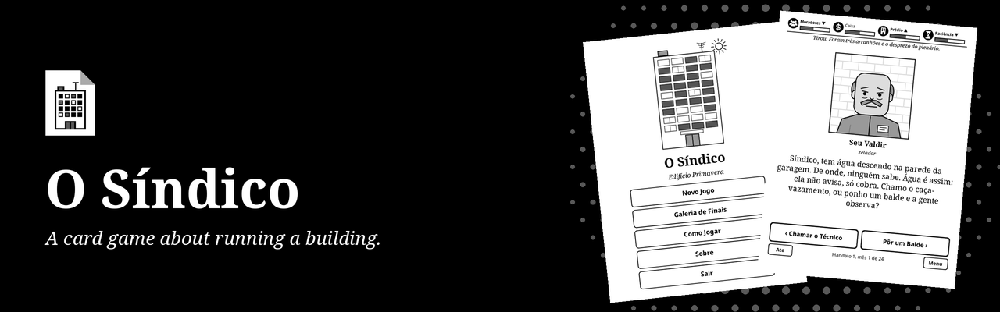
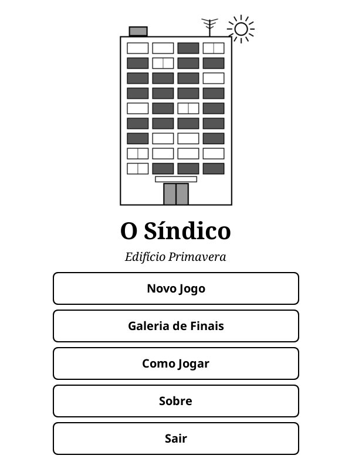
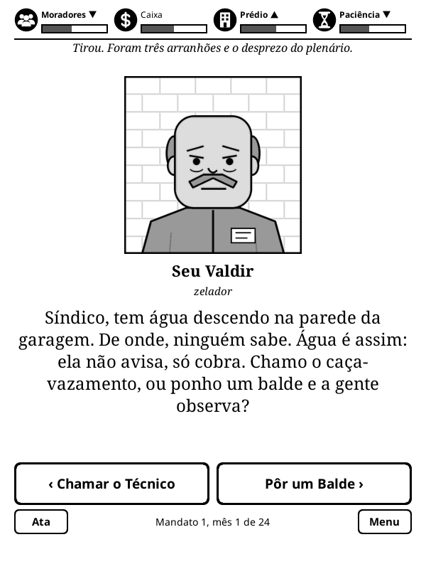
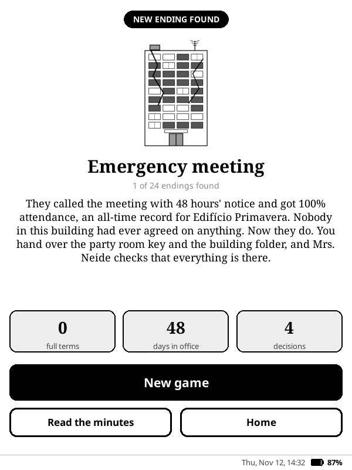

<p align="center">
  
</p>

<p align="center">
  <strong>You were elected building manager. We are sorry. A card decision game for KOReader, in Portuguese.</strong>
</p>

<p align="center">
  <a href="https://github.com/beater-studios/sindico_game.koplugin/releases/latest"></a>
  <a href="https://github.com/beater-studios/sindico_game.koplugin/actions/workflows/ci.yml"></a>
  <a href="https://koreader.rocks"></a>
  
  <a href="NOTICE"></a>
</p>

<p align="center">
  <a href="#what-it-does">What it does</a> ·
  <a href="#installation">Installation</a> ·
  <a href="#how-it-works">How it works</a> ·
  <a href="#development">Development</a> ·
  <a href="README_pt.md">Leia em português</a>
</p>

## What it does

<table>
  <tr>
    <td width="33%" align="center"><br><sub><b>Home</b></sub></td>
    <td width="33%" align="center"><br><sub><b>A card</b></sub></td>
    <td width="33%" align="center"><br><sub><b>An ending</b></sub></td>
  </tr>
</table>

You have just been elected building manager (síndico) of Edifício Primavera, a 12 storey apartment building. Each card is a resident, an employee or a supplier with a request, and you pick one of two answers. The chicken on the balcony, the leak nobody can trace and the four hour residents' meeting are all your problem.

- **Four meters:** Residents, Funds, Building and Patience. If any of them reaches 0, the game ends, each with its own ending.
- **Terms:** there is an accounts meeting halfway through a term and an election at the end. Each reelection makes it harder. Surviving 5 terms leads to the manager for life ending.
- **Memory:** your decisions unlock later cards and come back to collect months later.
- **Content:** 266 cards, 18 characters, 15 story arcs and 24 endings to discover, kept in a gallery.
- **Minutes:** the record of your notable decisions, which sums up the story of each game.
- **Sleep screen:** if the device sleeps with the game open, it shows the O Síndico cover instead of the book cover. This applies when the KOReader sleep screen is set to show the book cover.
- **Offline:** no internet, no data collected. Progress is saved after every decision.

## Installation

1. Download `sindico_game.koplugin.zip` from the [latest release](https://github.com/beater-studios/sindico_game.koplugin/releases/latest).
2. Extract it into `koreader/plugins/`, so that `koreader/plugins/sindico_game.koplugin/main.lua` exists.
3. Restart KOReader. The game is in the Tools menu, as **O Síndico**.

Progress is in `koreader/settings/sindico_game.lua`, and KOReader keeps the previous version next to it, as `sindico_game.lua.old`. To uninstall, remove the plugin folder and, if you like, these two files.

## How it works

Swipe the card to the left or to the right, or tap one of the two answers. After each decision, arrows show which meters went up or down, and a double arrow is a big change. Each decision takes a few days of the term: at the end of the first year come the accounts, and at the end of the second, the election, where you need Residents at 50 or more to stay.

<details>
<summary><b>Terms, memory and the gallery</b></summary>

<br>

- **Reelection:** the meters move a third of the way back to 50, the cards come back and the bad effects get 15% stronger with each term.
- **Consequences:** some answers set facts that unlock other cards, or schedule a card for weeks or months later. A story arc can run through a whole term.
- **Endings:** a meter at zero, a lost election, a few special answers and the fifth term each have their own endings. The gallery keeps the ones you found and your records between games.
- **Saved games:** the game is saved after every decision, so **Continue** picks up where you left off. A save from an older version that no longer fits the cards is dropped without losing the gallery.

The card format, the engine rules and the tools are in [docs/design.md](docs/design.md).

</details>

## Compatibility

- Made for KOReader 2026.07 and for touchscreens, always in portrait. It was developed for a 10th generation basic Kindle (firmware 5.18.1).
- Layout checked in the emulator at 600x800, 758x1024, 1072x1448 and 1264x1680.
- Uses only what comes with KOReader, with nothing else to install.
- The game is only in Portuguese for now. English and Spanish are on the roadmap.

## Development

With [LuaJIT](https://luajit.org) and `zip` installed, from the repository root, the same checks as the CI: the card validator, the tests, a thousand simulated games and the package.

```sh
sh tools/check.sh
```

The card format, the engine rules, the remaining tools and the release process are described in [docs/design.md](docs/design.md). When proposing new cards, run the validator and follow the advice there. Contributions are accepted under the project's licenses.

## License

The project has two licenses. The details are in [NOTICE](NOTICE).

- **Code:** [GPL-3.0](LICENSE), version 3 only. You may use, study, modify and redistribute it, keeping it open under the same license.
- **Content:** [CC BY-NC-SA 4.0](LICENSE-CONTENT) for the cards, characters, story and art (`data/`, `assets/`, `docs/screenshots/`, `docs/brand/`, `docs/social-preview.png` and `tools/make_art.py`). You may share and adapt it, with credit and under the same license, for non-commercial use.

These licenses grant no rights to the names "O Síndico" and "Beater Studios". For other uses, contact [Beater Studios](https://beaterstudios.com/).

---

<p align="center">
  <sub>Made by <a href="https://beaterstudios.com/">Beater Studios</a></sub>
</p>
