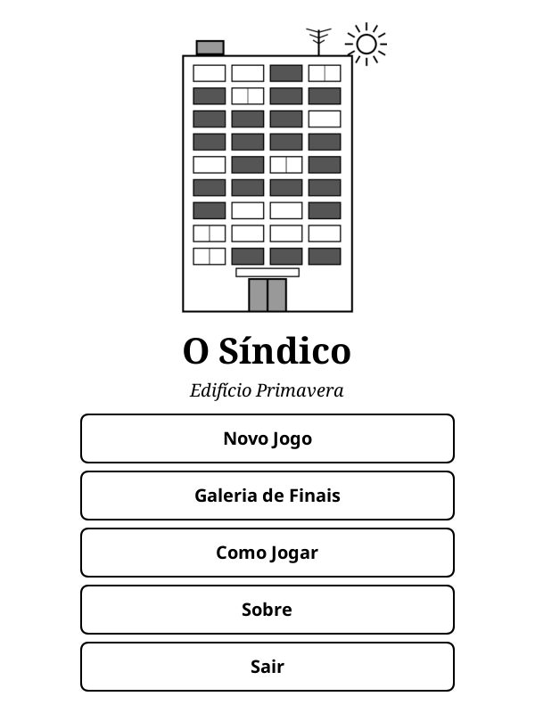
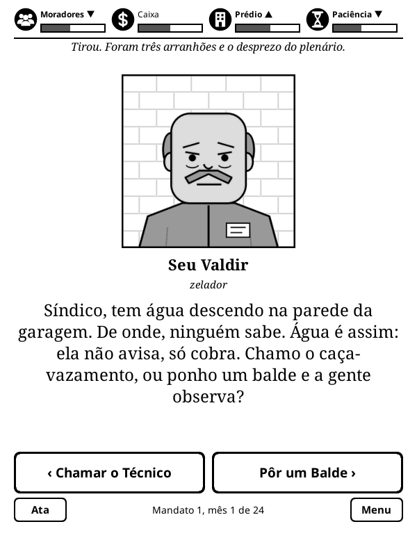
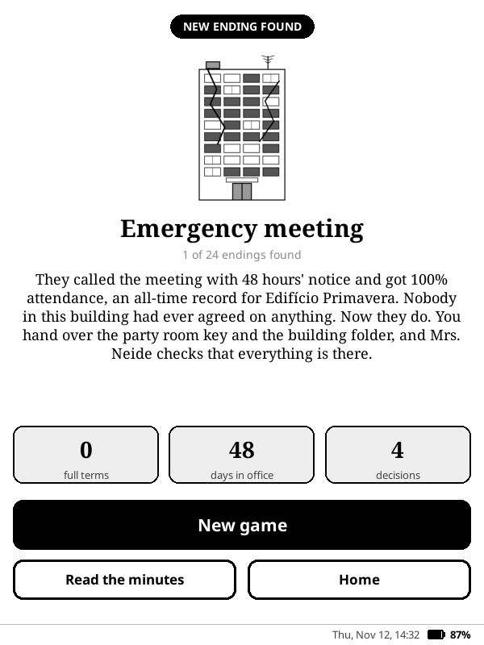

# O Síndico

[Leia em português](README.md)

A card-based decision game for [KOReader](https://koreader.rocks). The name means "The Building Manager". **The game text is currently in Brazilian Portuguese only**: see the [roadmap](#roadmap).

You have just been elected manager of Edifício Primavera, a 12-floor apartment building. Each card is a resident, employee or supplier with a request, and you pick one of two answers. The chicken on the balcony, the leak nobody can trace and the four-hour residents' meeting are all your problem now.

A game by [Beater Studios](https://beaterstudios.com/).

| Title | Card | Ending |
|---|---|---|
|  |  |  |

## The game

- **Four meters:** Residents, Funds, Building and Patience. If any of them reaches 0 the game ends, each with its own ending.
- **Terms:** there is a budget review mid-term and an election at the end. Each re-election makes things harder. Winning 5 terms leads to the manager-for-life ending.
- **Memory:** your decisions unlock future cards and come back to haunt you months later.
- **Content:** 266 cards, 18 characters, 15 story arcs and 24 endings to discover, kept in a gallery.
- **Minutes:** a record of your notable decisions that sums up the story of each game.
- **No internet:** it works offline and collects no data. Progress is saved after every decision.

## Installation

1. Download `sindico_game.koplugin.zip` from the [latest release](https://github.com/beater-studios/sindico_game.koplugin/releases/latest).
2. Extract it into `koreader/plugins/`, so that `koreader/plugins/sindico_game.koplugin/main.lua` exists.
3. Restart KOReader. The game is in the Tools menu, as **O Síndico**.

Progress is stored in `koreader/settings/sindico_game.lua`. To uninstall, delete the plugin folder and, if you wish, that file.

## Compatibility

- Tested with KOReader 2026.07 on a 10th generation basic Kindle (firmware 5.18.1).
- Layout checked in the emulator at 600x800, 758x1024, 1072x1448 and 1264x1680.
- Requires a touchscreen.
- The game always runs in portrait. Opened in landscape, it rotates the screen and restores the rotation on exit.

## Roadmap

- [ ] English translation
- [ ] Spanish translation

## Development

With [LuaJIT](https://luajit.org) installed, from the repository root:

```sh
luajit tools/validate.lua
luajit tests/engine_spec.lua
luajit tools/simulate.lua
```

The card format, engine rules, remaining tools and release process are described in [docs/design.md](docs/design.md), in Portuguese. Contributions are accepted under the project's licenses.

## License

This project has two licenses. See [NOTICE](NOTICE) for details.

- **Code:** [GPL-3.0](LICENSE), version 3 only. You may use, study, modify and redistribute it, keeping it open under the same license.
- **Content:** [CC BY-NC-SA 4.0](LICENSE-CONTENT) for cards, characters, story and art (`data/`, `assets/`, `docs/screenshots/`, `docs/social-preview.png` and `tools/make_art.py`). You may share and adapt it with credit and under the same license, for non-commercial purposes.

These licenses grant no rights to the names "O Síndico" and "Beater Studios". For other uses, contact [Beater Studios](https://beaterstudios.com/).
