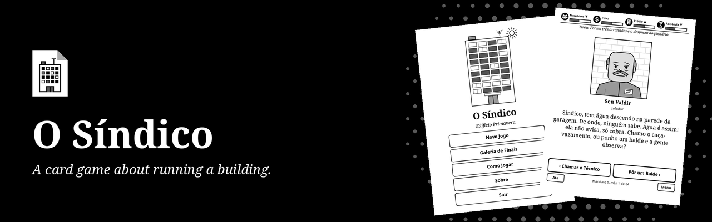
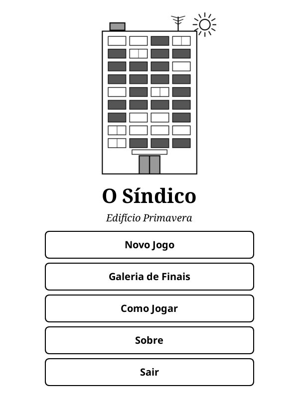
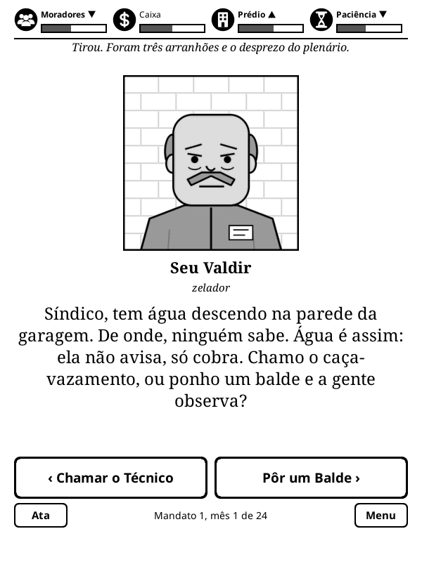
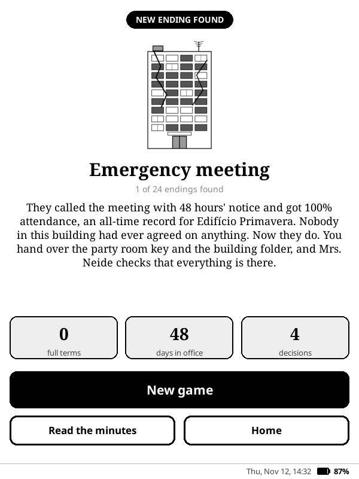

<p align="center">
  
</p>

<p align="center">
  <strong>Você foi eleito síndico. Sentimos muito. Jogo de decisões por cartas para o KOReader, em português.</strong>
</p>

<p align="center">
  <a href="https://github.com/beater-studios/sindico_game.koplugin/releases/latest"></a>
  <a href="https://github.com/beater-studios/sindico_game.koplugin/actions/workflows/ci.yml"></a>
  <a href="https://koreader.rocks"></a>
  
  <a href="NOTICE"></a>
</p>

<p align="center">
  <a href="#o-que-ele-faz">O que ele faz</a> ·
  <a href="#instalação">Instalação</a> ·
  <a href="#como-funciona">Como funciona</a> ·
  <a href="#desenvolvimento">Desenvolvimento</a> ·
  <a href="README.md">Read in English</a>
</p>

## O que ele faz

<table>
  <tr>
    <td width="33%" align="center"><br><sub><b>Início</b></sub></td>
    <td width="33%" align="center"><br><sub><b>Uma carta</b></sub></td>
    <td width="33%" align="center"><br><sub><b>Um final</b></sub></td>
  </tr>
</table>

Você acaba de ser eleito síndico do Edifício Primavera, um prédio de 12 andares. Cada carta é um morador, funcionário ou fornecedor com um pedido, e você decide por uma de duas respostas. A galinha na varanda, o vazamento sem origem e a assembleia de quatro horas são todos problema seu.

- **Quatro medidores:** Moradores, Caixa, Prédio e Paciência. Se qualquer um chegar a 0, o jogo acaba, cada um com seu final.
- **Mandatos:** há prestação de contas no meio do mandato e eleição no fim. A cada reeleição, fica mais difícil. Vencer 5 mandatos leva ao final de síndico vitalício.
- **Memória:** suas decisões liberam cartas futuras e voltam a cobrar a conta meses depois.
- **Conteúdo:** 266 cartas, 18 personagens, 15 arcos e 24 finais para descobrir, guardados numa galeria.
- **Ata:** o registro das suas decisões marcantes, que resume a história de cada partida.
- **Tela de descanso:** se o aparelho dorme com o jogo aberto, aparece a capa do Síndico no lugar da capa do livro. Vale quando a tela de descanso do KOReader mostra a capa do livro.
- **Sem internet:** funciona offline e não coleta dados. O progresso é salvo a cada decisão.

## Instalação

1. Baixe `sindico_game.koplugin.zip` na [última release](https://github.com/beater-studios/sindico_game.koplugin/releases/latest).
2. Extraia em `koreader/plugins/`, de modo que exista `koreader/plugins/sindico_game.koplugin/main.lua`.
3. Reinicie o KOReader. O jogo fica no menu Ferramentas, como **O Síndico**.

O progresso fica em `koreader/settings/sindico_game.lua`, e o KOReader guarda a versão anterior ao lado, como `sindico_game.lua.old`. Para desinstalar, apague a pasta do plugin e, se quiser, esses dois arquivos.

## Como funciona

Deslize a carta para a esquerda ou para a direita, ou toque numa das duas respostas. Depois de cada decisão, as setas mostram os medidores que subiram ou desceram, e seta dupla é mudança grande. Cada decisão consome alguns dias do mandato: no fim do primeiro ano vem a prestação de contas e, no fim do segundo, a eleição, em que é preciso ter Moradores em 50 ou mais para continuar.

<details>
<summary><b>Mandatos, memória e galeria</b></summary>

<br>

- **Reeleição:** os medidores voltam um terço do caminho para 50, as cartas voltam ao baralho e os efeitos ruins ficam 15% mais fortes a cada mandato.
- **Consequências:** algumas respostas marcam fatos que liberam outras cartas, ou agendam uma carta para semanas ou meses depois. Um arco pode atravessar um mandato inteiro.
- **Finais:** medidor zerado, eleição perdida, algumas respostas especiais e o quinto mandato têm finais próprios. A galeria guarda os que você descobriu e os seus recordes entre partidas.
- **Partida salva:** o jogo salva a cada decisão, e o **Continuar** retoma de onde parou. Um save de uma versão anterior que não serve mais às cartas é descartado sem perder a galeria.

O formato das cartas, as regras do motor e as ferramentas estão em [docs/design.md](docs/design.md), em inglês.

</details>

## Compatibilidade

- Feito para o KOReader 2026.07 e para telas sensíveis ao toque, sempre em retrato. Foi desenvolvido para um Kindle básico da 10ª geração (firmware 5.18.1).
- Layout conferido no emulador em 600x800, 758x1024, 1072x1448 e 1264x1680.
- Usa só o que vem com o KOReader, sem nada mais para instalar.
- O jogo está só em português por enquanto. Inglês e espanhol estão nos planos.

## Desenvolvimento

Com o [LuaJIT](https://luajit.org) e o `zip` instalados, a partir da raiz do repositório, as mesmas conferências da CI: o validador das cartas, os testes, mil partidas simuladas e o pacote.

```sh
sh tools/check.sh
```

O formato das cartas, as regras do motor, as demais ferramentas e o processo de release estão em [docs/design.md](docs/design.md), em inglês. Ao propor cartas novas, rode o validador e siga os cuidados descritos lá. Contribuições são aceitas sob as licenças do projeto.

## Licença

O projeto tem duas licenças. Os detalhes estão no [NOTICE](NOTICE).

- **Código:** [GPL-3.0](LICENSE), somente a versão 3. Você pode usar, estudar, modificar e redistribuir, mantendo-o aberto sob a mesma licença.
- **Conteúdo:** [CC BY-NC-SA 4.0](LICENSE-CONTENT) para cartas, personagens, história e arte (`data/`, `assets/`, `docs/screenshots/`, `docs/brand/`, `docs/social-preview.png` e `tools/make_art.py`). Você pode compartilhar e adaptar, com crédito e a mesma licença, sem uso comercial.

Estas licenças não dão direito aos nomes "O Síndico" e "Beater Studios". Para outros usos, fale com a [Beater Studios](https://beaterstudios.com/).

---

<p align="center">
  <sub>Feito pela <a href="https://beaterstudios.com/">Beater Studios</a></sub>
</p>
